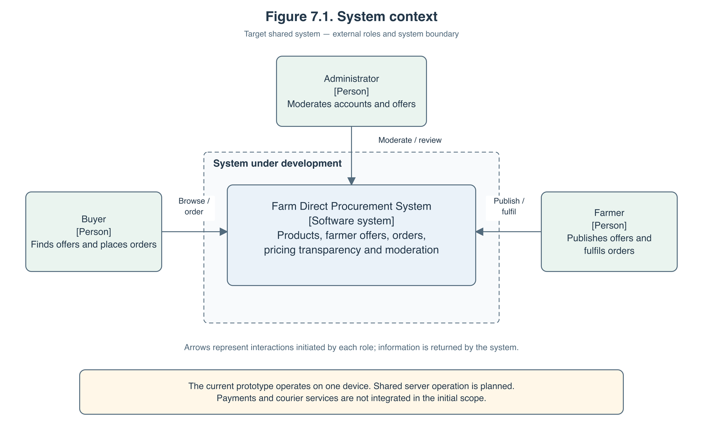
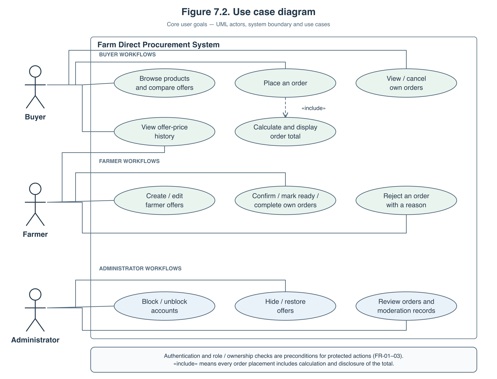
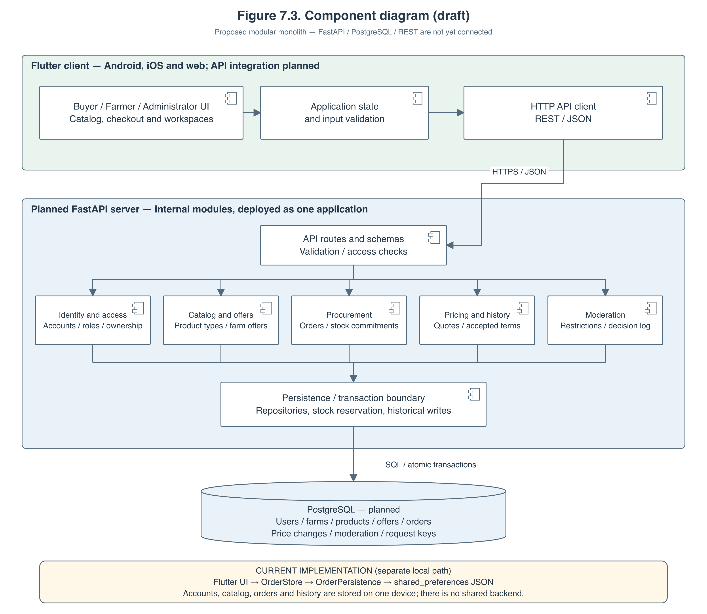

# 7. Architecture and Diagrams

[Documentation index](README.md) · [Complete report with figures](report/farm-direct-pre-defense-report.docx)

This is a readable copy of the corresponding section of the supplied English report. The complete Word report retains its original text, layout and figures.

[Editable source and export guide](../diagrams/README.md) · [Three-page diagrams.net source](../diagrams/farm-direct-architecture.drawio)

The figures below publish the existing Section 7 diagrams. The proposed shared
architecture and the current local prototype are identified separately in both
the descriptions and the figures. Related decisions and criteria are documented
in the [technology comparison](technology-comparison.md),
[requirements specification](requirements-specification.md) and
[verification plan](verification-and-evaluation-plan.md).
Publication is tracked in [FARM-16](https://farm-direct-procurement.youtrack.cloud/issue/FARM-16).

## 7.1. Architectural Overview

The proposed system follows a client–server architecture comprising a Flutter client, a FastAPI backend, and a PostgreSQL database. The client targets Android, iOS, and web and communicates with the backend through a REST-style JSON API over HTTPS.

The backend is planned as a modular monolith: one deployed application containing separate modules for identity and access, catalog management, procurement, pricing history, and moderation. This structure provides identifiable responsibilities while keeping deployment manageable for the project team.

The architecture distinguishes the intended shared system from the current implementation. The existing prototype uses Flutter screens, a shared OrderStore, and local JSON persistence through shared_preferences. The backend, shared database, and network integration remain planned.

## 7.2. System Context Diagram

Figure 7.1 identifies the system boundary and its three external user roles.

Buyers discover products, compare offers, and place orders. Farmers publish offers and manage fulfilment. Administrators moderate accounts and offers and review relevant records.

Client applications, backend modules, and persistence belong inside the system boundary. Payment processors and courier services are excluded from the initial integration scope.

[SVG export of Figure 7.1](../diagrams/figure-7-1-system-context.svg)

## 7.3. Use Case Diagram

Figure 7.2 presents the main user goals. Buyer use cases cover offer comparison, price-history inspection, order placement, and management of existing orders. Farmer use cases cover offer management, price-history inspection, order progression, and rejection with a reason. Administrator use cases cover account restrictions, offer visibility, and record inspection.

The «include» relationship indicates that placing an order includes calculation and disclosure of its total. Authentication and role or ownership checks are preconditions for protected operations.

[SVG export of Figure 7.2](../diagrams/figure-7-2-use-cases.svg)

## 7.4. Component Diagram

Figure 7.3 shows the proposed components and their dependencies. The Flutter client separates user interfaces, application state, and API communication. Client validation supports interaction, while the server remains authoritative for permissions and business rules.

API routes validate incoming requests and coordinate the internal modules. Persistence operations use a transaction boundary to maintain consistency between orders, stock commitments, and historical records.

The diagram describes logical responsibilities. It does not imply that every box is a separate deployed service or an already implemented backend component.

[SVG export of Figure 7.3](../diagrams/figure-7-3-components.svg)

| Component | Responsibility |
| --- | --- |
| Flutter interfaces and application state | Present role-specific screens, collect input, display quotes and statuses, and manage interaction state. |
| HTTP API client | Send authenticated requests, interpret responses, and handle validation errors, conflicts, and interrupted submissions. |
| API routes and schemas | Define request and response contracts and apply validation and access checks. |
| Identity and access | Manage accounts, authentication, roles, ownership checks, and blocked-account restrictions. |
| Catalog and offers | Manage product types, farm offers, availability, purchasing conditions, search, and filtering. |
| Procurement | Manage order creation, stock commitments, permitted transitions, cancellation, rejection, and duplicate-submission handling. |
| Pricing and history | Calculate quotes, prepare accepted-price snapshots, and record successful changes to pricing and delivery terms. |
| Moderation | Manage account restrictions, offer visibility, and dated administrator decisions. |
| Persistence and transaction boundary | Coordinate database reads and atomic writes, including reservations and historical records. |
| PostgreSQL | Store shared accounts, farms, products, offers, orders, price changes, moderation records, and request identifiers. |

## 7.5. Data Organisation

The planned data model contains the following principal relationships:

- A farmer account is associated with a farm.

- A farm publishes offers.

- Each offer belongs to one product type, allowing offers from different farms to be grouped for comparison.

- Each order belongs to one buyer and references one offer.

- Each order stores accepted purchasing terms separately from the offer’s current values.

- Price-change records reference the relevant offer and farm.

- Moderation records identify the administrator, target, action, reason, and timestamp.

- Request identifiers link repeated submissions to their original result.

The initial order model concerns one offer per order. Combined checkout across several farms is outside the initial release scope.

## 7.6. Order Placement and Fulfilment Scenario

The planned order-placement scenario proceeds as follows:

1. The buyer selects a product, chooses a farmer offer, and enters the quantity and fulfilment details.

2. The client displays the subtotal, delivery charge, and total before submission.

3. The backend checks the authenticated buyer, offer visibility, current price, minimum quantity, and available stock.

4. A coordinated database transaction records the order, its accepted terms, the stock reservation, and the submission identifier.

5. The buyer receives the order reference and Awaiting confirmation status. The farmer can retrieve the order through their workspace.

6. Authorised farmer actions move the order through Confirmed, Ready, and Completed.

Cancellation or rejection releases the reservation exactly once. Completion consumes the ordered quantity. Later changes to the offer do not rewrite the order’s accepted terms.

For interrupted requests, the backend uses the submission identifier to return the existing result rather than create another order. These shared-system behaviours remain implementation requirements.

## 7.7. Requirements-to-Architecture Traceability

| Requirements | Responsible components |
| --- | --- |
| FR-01–FR-03: registration, authentication, and permissions | Identity and access; API access checks; role-specific interfaces. |
| FR-04–FR-05, FR-18: catalog, comparison, search, and filtering | Catalog and offers; buyer interface. |
| FR-06, FR-08: calculations and preserved purchasing terms | Pricing and history; procurement; transaction boundary. |
| FR-07, FR-09, FR-11: order submission, history, cancellation, and fulfilment | Procurement; buyer and farmer interfaces. |
| FR-10: farmer offer management | Catalog and offers; identity and access; farmer interface. |
| FR-12: consistent stock commitments | Procurement; database transactions and concurrency controls. |
| FR-13: dated offer-price history | Pricing and history; persistence; buyer and farmer interfaces. |
| FR-14–FR-15: moderation and administrator records | Moderation; identity and access; administrator interface. |
| FR-16: shared data across devices | HTTP API client; backend modules; PostgreSQL. |
| FR-17: duplicate-submission prevention | HTTP API client; procurement; stored request identifiers. |

Platform compatibility and responsive interaction are addressed by the Flutter client. Secure access depends on backend enforcement. Transactional integrity and recoverability depend on the persistence design and database operation. These qualities require verification beyond the diagrams.

## 7.8. Current Implementation and Transition

The current prototype implements local role workflows, catalog browsing, offer comparison, pricing, order processing, price history, and moderation through OrderStore.

Its local role checks and persistence demonstrate behaviour on one device. They do not provide trusted server authorisation or shared inventory.

The next architectural step is to implement the API and database, introduce the client API layer, and move authoritative permissions, pricing validation, stock commitments, and historical writes to the backend. This transition will be verified against the requirements in Section 6 and the verification plan in Section 9.
