# Buyer, Farmer and Administrator Procurement Prototype

This implementation covers product discovery, comparison of farmer offers,
price calculation, demo checkout, local order history, farmer confirmation, and
farmer-managed product offers, complete order transitions, recorded price history,
local account registration, role-specific workspaces and administrator moderation.
It is a Flutter application with shared UI for
Android, iOS, and web. All farms, inventory, and prices are fictional fixtures.
Product photography is illustrative and generated; it does not depict real
listed stock. See [image sources and prompts](image-sources.md).

## Demonstration

1. Sign in as `buyer@farm.demo` with demo password `FarmDemo2026!`, then search
   the catalog for potatoes. Search ignores case and surrounding
   spaces. Category filters combine with the search; reset clears both.
2. Open Potatoes. Three distinct farmer offers appear, sorted by unit price.
3. Compare stock, minimum quantity, location, pickup, and delivery charges.
4. Select Delivery available to exclude the pickup-only offer. Use the sort menu
   to sort by farm name instead of unit price.
5. Open Bereke Family Farm. The minimum quantity is 50 kg at KZT 190 per kg.
6. Pickup totals KZT 9,500. Selecting delivery adds KZT 2,500 for KZT 12,000.
7. Enter 49 kg or 801 kg. The quantity is rejected and no misleading total is
   displayed. Enter 100 kg with delivery to see KZT 21,500.
8. Choose Continue to checkout. Use sample details such as Demo Buyer,
   +7 700 000 00 00 and Demo city, Sample Street 1. Delivery requires an address;
   pickup does not. Quantity can still be changed before placing the order.
9. With 50 kg and delivery, place the demo order. Confirmation displays a unique
   local number and KZT 12,000 total with Awaiting confirmation status.
10. Open View all orders, then view the order details. The unit price, delivery fee,
    quantity and total are snapshots of the accepted offer.
11. Refresh/relaunch, sign in again as the same buyer and use Orders in the catalog header. The same order remains
    on this device/browser. Clearing browser/app data removes this local history.
12. Cancel an awaiting order from its details, confirm the dialog, and use the
    Active / Cancelled history filters. The saved price stays visible and its
    quantity becomes available again in the local demo catalog.

Search and category selection survive navigation back from the offers screen.
Pickup and delivery are both supported through checkout. Validation prevents
missing contacts, invalid phone format, missing delivery address, below-minimum
quantities and ordering above the local remaining stock. Repeated clicks and
failed saves do not create duplicate orders or phantom stock reservations.

To demonstrate an empty delivery result, open Wheat and enable Delivery available.
Reset filters returns to its pickup offer.

## Farmer Confirmation Demonstration

1. Create another buyer order from Bereke Family Farm. Keep it awaiting confirmation.
2. Sign out from the buyer catalog and sign in as `bereke@farm.demo` with
   `FarmDemo2026!`. The farmer workspace opens for Bereke Family Farm only.
3. The Awaiting filter shows only orders belonging to the selected farm, with
   buyer name, product, quantity, fulfillment and saved total. Check Confirmed and
   All orders to see the other statuses, including cancelled orders.
4. Open the awaiting order. Inspect the original unit price, fees, contact details,
   address/pickup region and note. Select Confirm demo order and accept the dialog.
5. The status becomes Confirmed and a confirmation timestamp appears. Saved price,
   quantity, delivery terms and stock reservation are unchanged. Confirmation does
   not reserve the same stock a second time.
6. Sign out, sign in as the same buyer, and open My orders. The same order now shows Confirmed, including
   after a refresh/relaunch. It can no longer be cancelled by the buyer in this
   prototype. Cancelled or confirmed orders cannot be confirmed again.
7. Sign out and sign in as `saryarka@farm.demo` to verify that Bereke orders do not appear there. If no
   orders exist, the empty state explains how to create an order for that farm.

Older local orders are mapped to farms by their known offer IDs when loaded.
Unknown historical offers remain in buyer history but are not assigned to any
farm. Legacy orders are assigned to `demo-buyer`. Local account checks now
enforce buyer ownership and the signed-in farmer’s farm for reads and writes.
These client checks require matching server enforcement before production use.

## Order Lifecycle Demonstration

The supported path is Awaiting confirmation → Confirmed → Ready → Completed.
Only the signed-in owning farmer can advance the order; stages cannot be
skipped, repeated or reversed. The ready action says Ready for pickup or Ready
for delivery according to the saved fulfillment method. Completion asks the
farmer to confirm that collection/delivery happened. Each successful transition
stores a timestamp and appears in both buyer and farmer views after a restart.

From Awaiting confirmation or Confirmed, the farmer can choose Reject order.
A trimmed reason of 5–300 characters is required and shown to the buyer with the
Rejected status. Rejection returns the quantity to local stock. After readiness,
rejection is unavailable. Buyer cancellation remains available only while
awaiting confirmation. Completed, Rejected and Cancelled are terminal statuses.
Completed quantities stay consumed; completing does not replenish stock.

To demonstrate, advance one order through confirmation, readiness and completion.
Place another order, reject it with “Harvest damaged during packing.”, then open
it from the buyer's My orders. Check the Completed/Rejected filters and verify
that rejected orders are absent from Active. All accepted prices and delivery
fees stay unchanged throughout the lifecycle. Save failures and concurrent
changes leave the preceding saved state intact rather than showing false success.

## Farmer Product Management Demonstration

1. Sign in as `bereke@farm.demo`, then open Manage products. The
   list shows its offers, current price, total stock, committed quantity and the
   quantity still available to new buyers.
2. Choose Add product. To join an existing comparison group, select a product type
   that this farm does not already list. Types already listed are disabled; edit
   their existing offers instead.
3. To create a new group, leave New product type selected. Enter Onions, category
   Vegetables, KZT 220/kg, total stock 100 kg, and minimum order 10 kg. Enable
   delivery and enter KZT 700. Add a pickup region and optional offer details.
4. Publish. The new product type and farm offer are saved together. Sign out and sign in as the buyer to open the
   catalog and search for Onions: a new product card shows Bereke's offer.
5. Sign in as the farmer again, return to Manage products and edit Onions to KZT 240/kg. Save, then refresh.
   The buyer still sees Onions at KZT 240/kg. A quote for 10 kg with delivery is
   KZT 2,400 + KZT 700 = KZT 3,100.
6. Existing orders retain their original price, quantity and delivery fee. If an
   offer changes while an old quote is open, checkout rejects that stale quote
   and asks the buyer to reopen the offer before ordering.
7. Total stock includes saved, non-cancelled orders. It cannot be set below the
   committed quantity. Zero stock pauses an uncommitted offer; offers without
   enough remaining stock for the minimum order are unavailable to new buyers.
   If no visible offer from an active farmer meets its minimum quantity, the
   product is also excluded from the buyer catalog, search, category results and
   product count. Another qualifying farmer keeps the product listed. Restocking
   or releasing order commitments makes it reappear automatically. The product
   and offer remain available in the farmer's management records, and accepted
   orders retain their original terms (FARM-20).
8. Signing in as another farmer shows that farm's product list. An offer cannot be
   edited on behalf of another farm. The product type of a published
   offer stays fixed to preserve comparison groups; all other listed terms can
   be edited. Product type names are unique, ignoring case and outer spaces.

Quantities are whole kg (up to 1,000,000); prices and per-order delivery fees are
whole KZT (up to 10,000,000). Price/minimum must be positive, stock and delivery
fee may be zero. Delivery can be disabled, while pickup is always free. Stock
must cover its minimum order unless zero. New types use a neutral image
placeholder; uploading product photography remains future work.

Catalog and orders share one versioned local save and one write lock. Version-1
order-only history migrates to version 2 with the original catalog, preserving
orders and their agreed terms. Failed writes publish neither a partial product
nor a partial offer. Unreadable saved data is preserved with session-only fallback.

## Price History Demonstration

Open Price history from either a buyer's farmer-offer card or the farmer's My
products list. The screen displays the current price/delivery terms and newest
recorded changes first. Each record shows date/time (including seconds), old and
new unit prices, increase/decrease in KZT per kg, and any delivery-fee change.
Delivery switching between pickup-only, free delivery and paid delivery is
recorded explicitly.

1. Open an existing offer with no history. The screen honestly reports that no
   price changes have been recorded; earlier prices/dates are unavailable.
2. Edit Onions from KZT 240 to KZT 260 per kg and save. The history shows
   KZT 240 → KZT 260, an increase of KZT 20/kg, with the actual local save time.
3. Change only stock or description. No price record is created. Change a delivery
   fee or delivery availability and a new record is created even if unit price
   stays unchanged. A new publication records its initial price and delivery terms.
4. Refresh/relaunch, then open the same history from the buyer's offer card. The
   records persist, while old orders keep their original agreed terms.

History records, catalog and orders are written together in version-3 local
storage. Versions 1 and 2 migrate with empty earlier price history; original order
and catalog data are preserved. Records are created only after successful saves,
so a failed edit produces neither a new price nor a false historical event. This
is a local demo log, not a server-authenticated audit trail.

## Pricing Scope

The demonstration uses whole kilograms and integer KZT amounts. Total equals
quantity times unit price plus the selected disclosed delivery fee. All offers
allow free pickup. A null delivery fee means that delivery is unavailable. Other
fees are explicitly zero in these fixtures. The displayed region is informational;
service-area validation is a later requirement.

## Current Boundaries

Orders are saved locally using shared_preferences for this demonstration. This is
not suitable as the authoritative store for real procurement or sensitive data;
use sample contact details. If history cannot be loaded, the app preserves it and
switches new orders to session-only mode with a visible notice. Failed writes
show an error and leave the previous order list and local stock unchanged.

No real order is sent to a farmer. The farmer workspace is a local demonstration.
Authentication is a local demonstration with salted password hashes and three
role-specific entry screens. There is no live backend, email verification,
password recovery, payment processing or image upload. Account blocking and
listing moderation are implemented locally; trusted enforcement still needs a server.
Stock deductions exist only in one device's demo history; they do not synchronize
between buyers. The server must later enforce inventory, authorization, durable
order snapshots and status transitions.

FARM-8 remains in progress until its complete acceptance criteria are reviewed.
The buyer can create an Awaiting confirmation order or cancel it. The farmer can
confirm, mark ready and complete an order, or reject it before readiness with a
reason. Changes are visible to the buyer on the same device. FARM-9 remains open
for full acceptance review and remaining server requirements. Price history is now
implemented locally; FARM-10's full server data contract and server-side pricing
enforcement remain future work.

## Accounts and Roles Demonstration

- Open Create an account. Choose Buy produce or Sell as a farmer; confirm a demo
  password of 8–128 characters. Farmer registration also requires a farm name and
  region and creates a new farm with no offers or orders. A matching email cannot
  be registered twice, including case-only changes.
- Buyer accounts see and cancel only their own awaiting orders. Farmers can edit
  offers and progress/reject orders only for their own farm. Public catalog and
  pricing data are shared on this device. Administrator accounts cannot be
  self-registered and cannot place/cancel orders or act as farmers.
- Sign in as `admin@farm.demo` / `FarmDemo2026!`. Inspect Accounts, Offers and Orders.
  Order details are read-only; counts reflect this device's current saved data.
- Use Sign out on the workspace header. Previous routes are removed so Back cannot
  reopen the previous account's screens. Restarting also requires sign-in, while
  registered accounts and business data remain saved.
- The local persistence schema is version 5. Versions 1–4 migrate without
  inventing owners: legacy orders map to the seeded Demo Buyer. Unreadable data is
  preserved and the app falls back to a visibly marked session-only demo.
- Passwords use per-account salts and PBKDF2-HMAC-SHA256 with 100,000 iterations
  through [cryptography](https://pub.dev/documentation/cryptography/latest/cryptography/Pbkdf2-class.html).
  Sessions are held only in memory. This is not a trusted authorization boundary
  against someone who can alter local storage; real multiuser operation requires
  backend authentication, access checks and storage.

## Administrator Moderation Demonstration

1. Sign in as `admin@farm.demo`. Accounts supports name/email/role search. Choose
   Block account on a buyer or farmer, supply a 5–300 character reason, and confirm.
   The status and reason update only after a successful save. Administrator accounts
   have a Protected administrator label and cannot be blocked.
2. Sign out and try the blocked account's correct credentials. Sign-in is refused
   with the reason. Re-registering the same email does not bypass the restriction.
   Sign back in as administrator and Unblock account with a review reason.
3. Open Offers and search by product or farm. Hide offer removes only that farmer's
   listing from comparison. If a product type has no visible offers, its catalog
   card disappears. An existing cached quote cannot be ordered after hiding.
4. Sign in as the owning farmer and open My products. The hidden listing remains
   editable with a Hidden by administrator notice and reason. Price/stock edits
   do not clear moderation. Sign in as administrator to Restore offer.
5. Blocking a farmer also excludes all that farm's offers from new purchases.
   Unblocking restores eligible offers, while offers explicitly hidden by an
   administrator remain hidden. Restoring a listing does not override a blocked
   farmer. Stock/minimum constraints still apply to visible offers.
6. Open History to inspect hide/restore and block/unblock decisions, their reason,
   administrator ID and timestamp. Refresh, sign in again and verify the saved
   statuses and history. Versions 1–4 start with no invented moderation records.

Moderation never rewrites or deletes accepted order terms, price history or stock
commitments. Existing orders remain in the owning buyer/farmer and administrator
histories. Blocking prevents that account's sign-in and new activity, rather than
automatically cancelling orders. Failed writes retain the preceding status and
history; concurrent writes cannot change the acting account or lose a decision.
This remains a same-device local demonstration, not shared server moderation.

## Screenshots

Captured from the running Flutter web client at a 390 by 844 viewport.
Earlier screenshots document previous increments; the current app starts at sign-in.

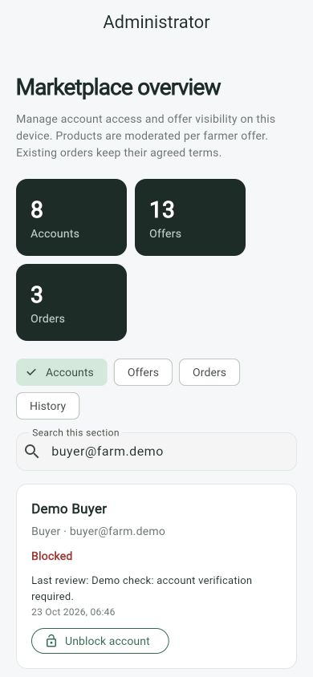

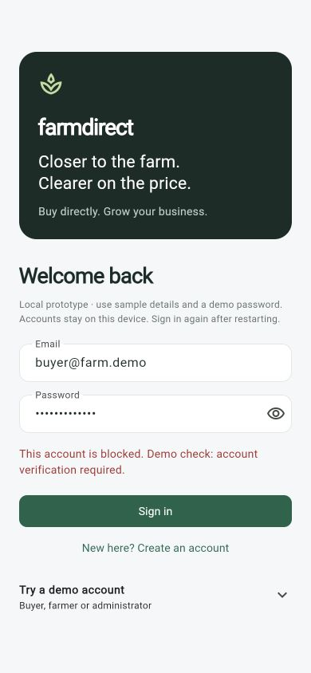

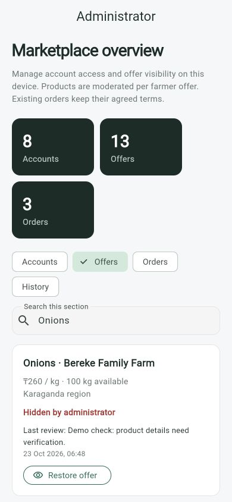

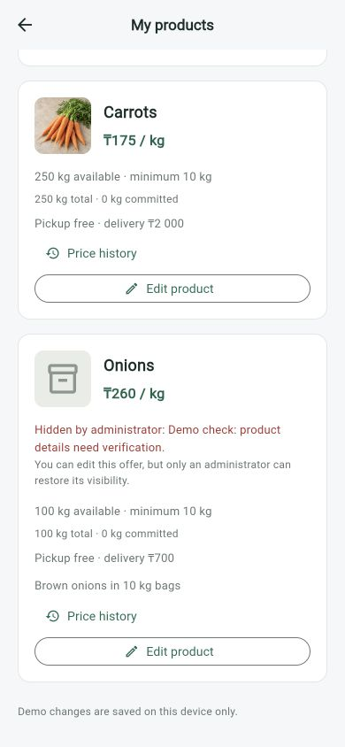

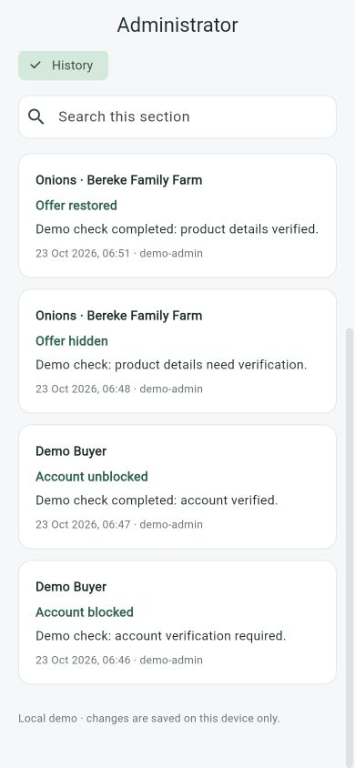

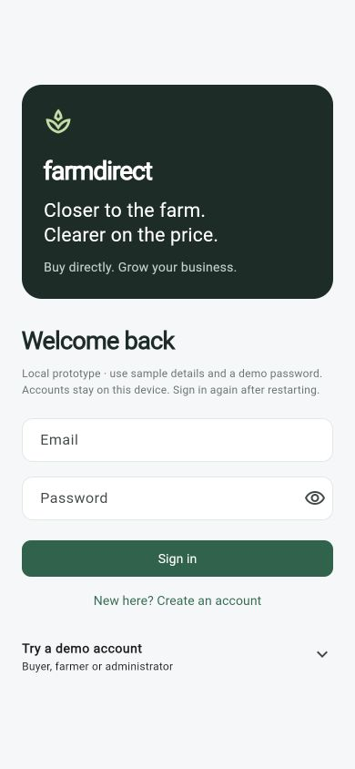

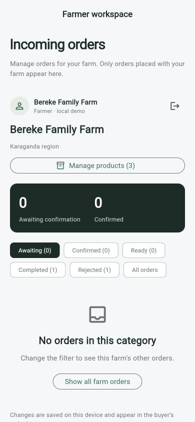

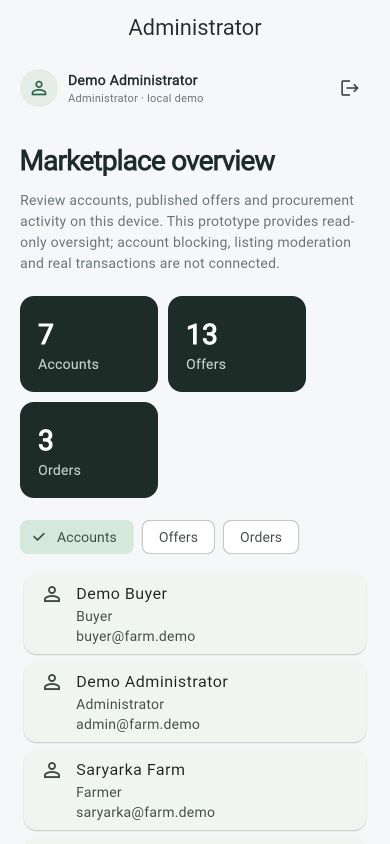

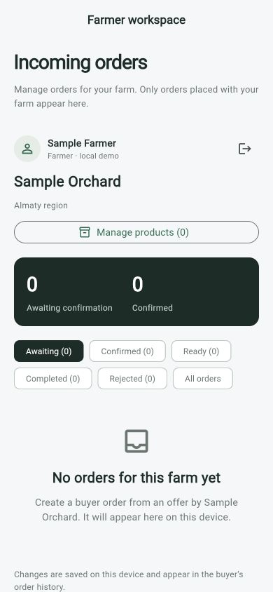

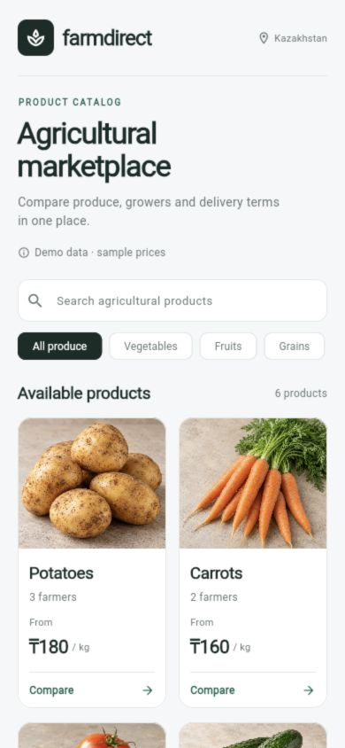

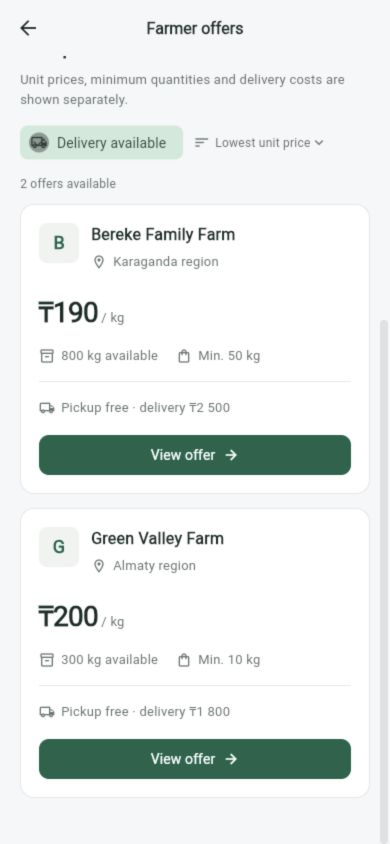

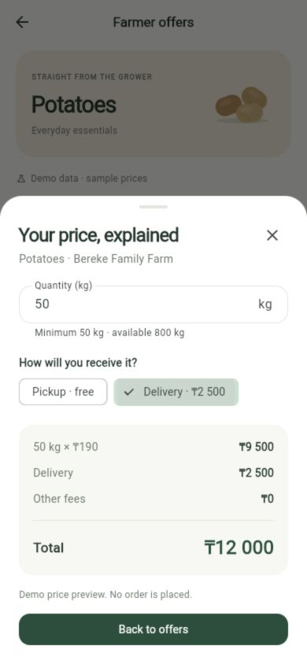

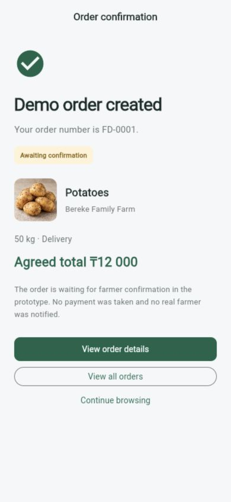

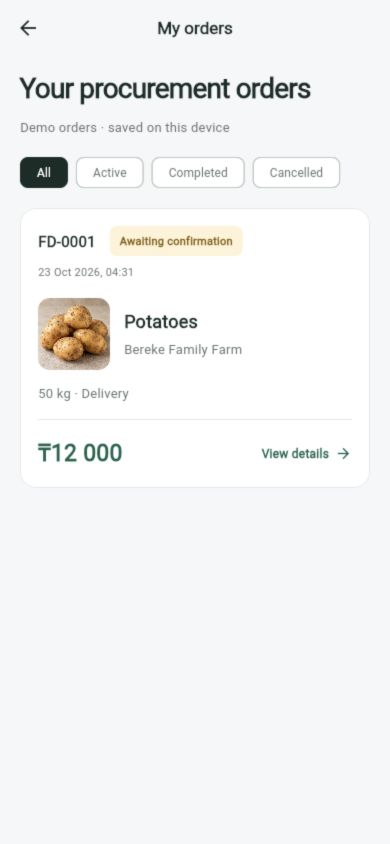

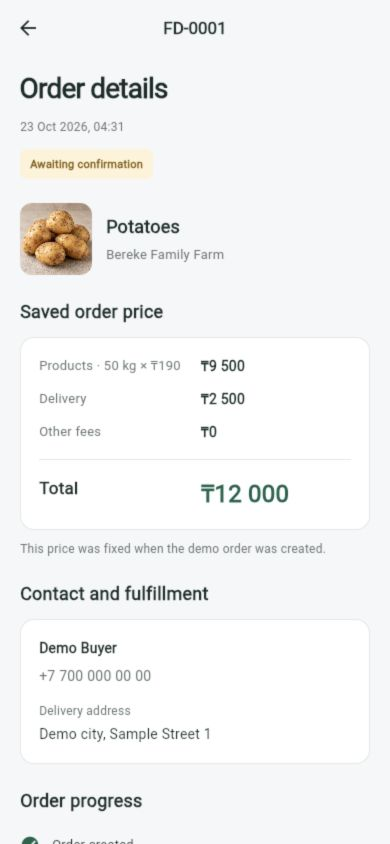

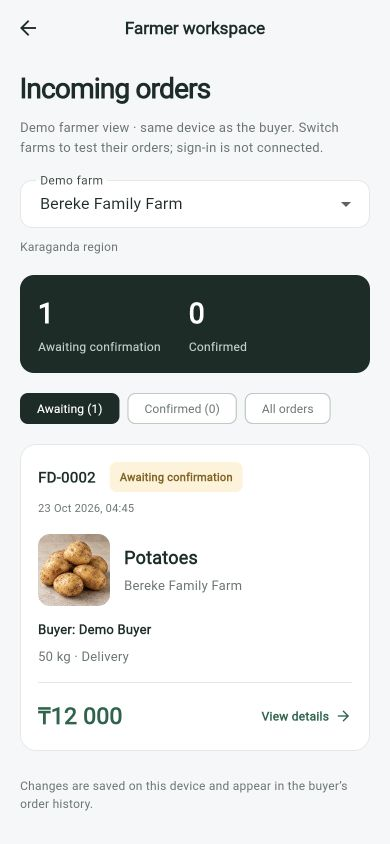

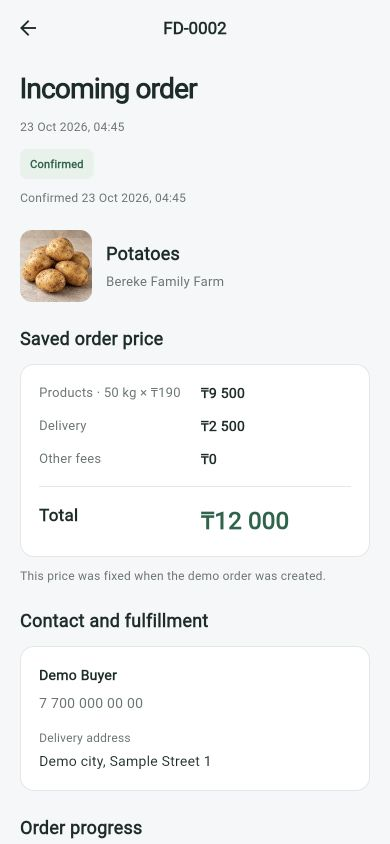

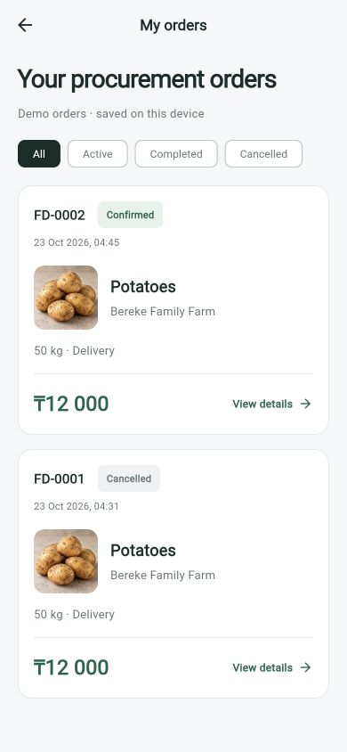

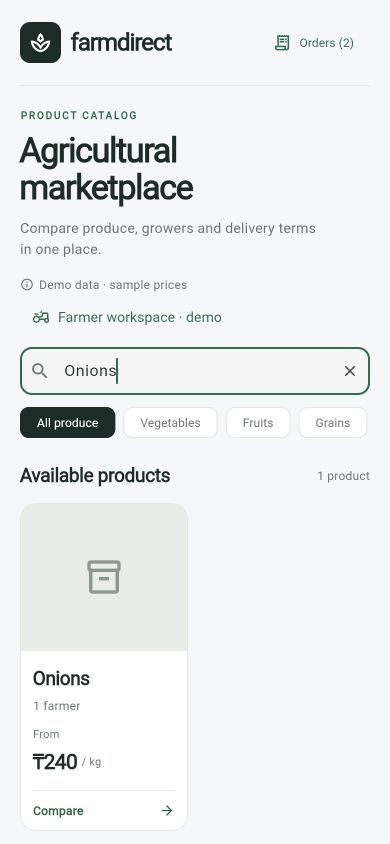

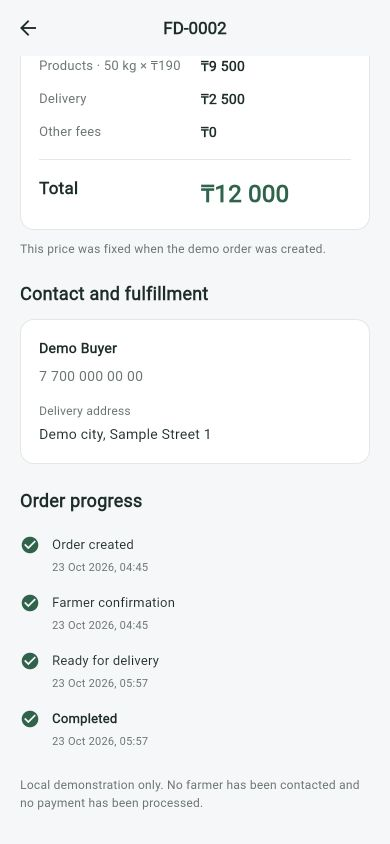

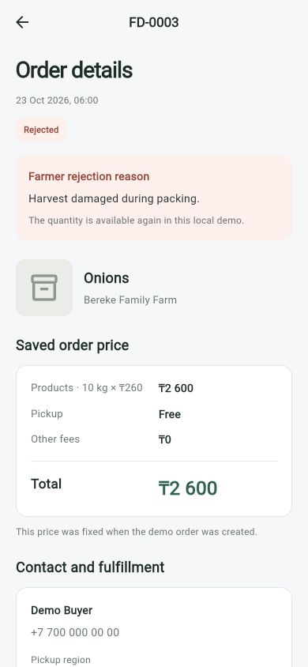

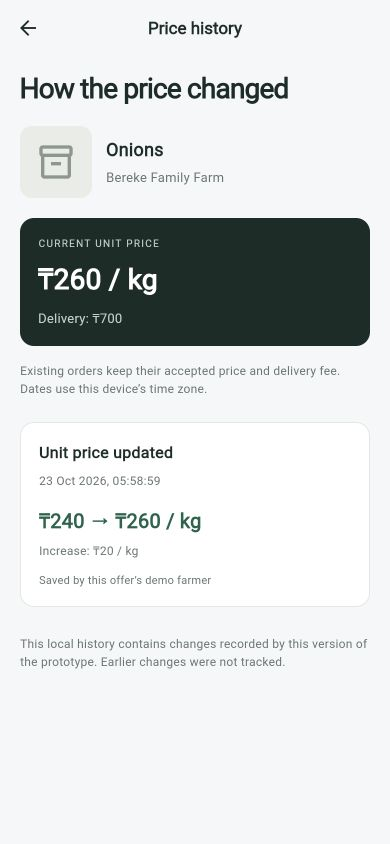

## Structure and Checks

- `apps/mobile/lib/admin`: moderation decisions and reason validation.

- `apps/mobile/lib/catalog`: farm/product/offer models, fixtures, quantity and price rules.
- `apps/mobile/lib/orders`: immutable order terms, validation, persistence and stock accounting.
- `apps/mobile/lib/ui`: catalog, offers, checkout, confirmation, buyer/farmer order lists and details.
- `apps/mobile/test`: business-rule and user-interaction checks.

Run `flutter analyze` and `flutter test` from `apps/mobile`. The 66 checks cover
pricing, filtering, narrow-screen catalog layout, checkout validation, creation,
history restoration, cancellation, overselling, concurrent saves, storage errors,
farm ownership, confirmation, immutable terms, legacy history migration and
narrow-screen farmer layout, product publication/editing, catalog restoration,
stock-edit constraints, stale quotes, duplicate prevention, atomic save failures
and the publication form on a narrow screen with larger text. Additional checks
cover valid/invalid lifecycle transitions, rejection reasons and released stock,
consumed completed stock, timestamps, transition save failures, concurrent actions,
price/delivery history, legacy migration and responsive history screens.
Nine account checks add all demo roles, invalid credentials, duplicate emails,
password hashing, registration rollback, independent farm ownership, buyer history
isolation, denied cross-role actions, administrator self-registration denial,
concurrent registration, signed-out restoration, legacy owner migration, login
errors, navigation reset and registration at 320 px with larger text.
Ten moderation checks add administrator-only actions, protected administrators,
required reasons, block/unblock persistence, hidden cached checkout rejection,
independent offer and farm restrictions, restoration rules, farmer-edit isolation,
unchanged saved terms, failed hide/restore and block/unblock saves, concurrent
moderation, schema v4 migration, corrupt history preservation, a narrow-screen
admin workflow and buyer/farmer visibility checks.
Three catalog-availability checks cover zero and below-minimum remaining stock,
the exact-minimum boundary, restocking and released commitments, alternative
farmers with moderation restrictions, and live buyer search/category/count
updates after order placement and cancellation.
The web release and iOS Simulator debug builds also pass. Manual browser verification at 390 × 844 covers
creation of a 50 kg delivery order, restart persistence, saved terms, cancellation
and history filters. Farmer verification adds account switching, farm-specific empty
states, confirmation and the persisted Confirmed status in buyer history.
Product-management verification publishes Onions, changes its price, refreshes,
and checks the updated catalog card and KZT 3,100 delivery quote. Lifecycle checks
complete a delivery order, reject another with a visible reason, and verify both
after refresh. History checks change Onions from KZT 240 to KZT 260 and inspect
the saved old/new values and timestamp.
Android runtime verification still requires an emulator/device
and locally accepted Android SDK licenses.

Account verification signs in as buyer, Bereke farmer and administrator at
390 × 844, checks preserved legacy orders, creates Sample Orchard as a new farm,
and signs into that saved farm again after refresh.

Moderation browser verification blocks Demo Buyer, observes refused sign-in with
its reason, then unblocks the account. It hides Onions, observes no buyer search
results, restarts and checks the farmer's hidden-offer notice, then restores the
offer and inspects the four dated decisions in History. Demo restrictions used
for this walkthrough are cleared at the end.
